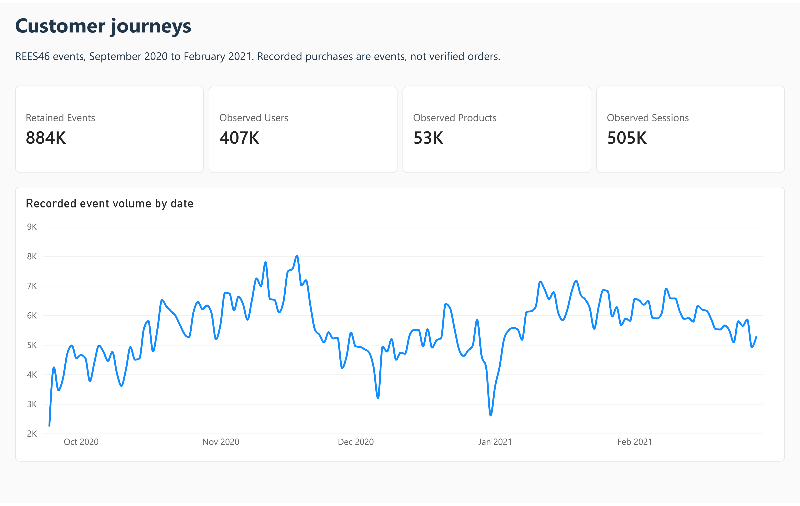
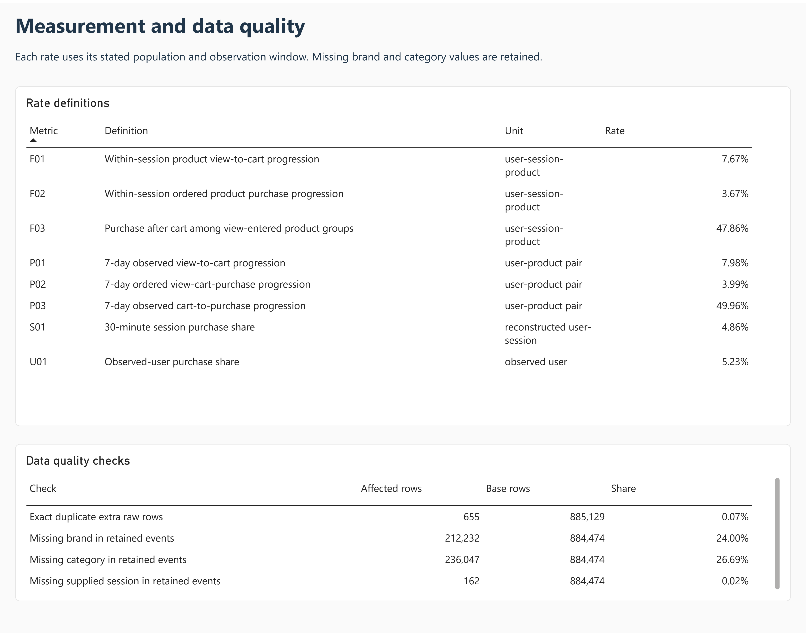
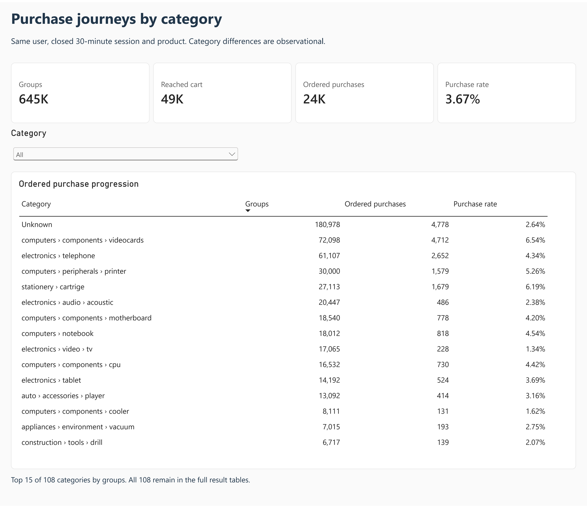
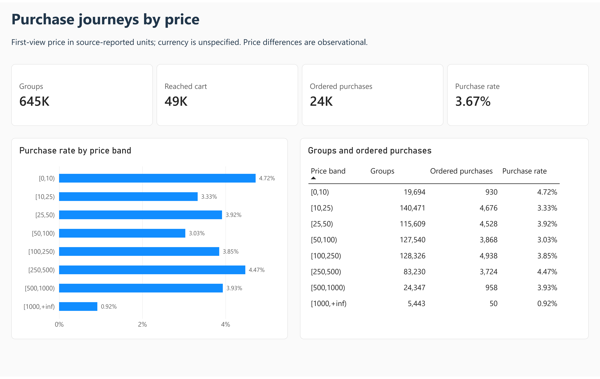
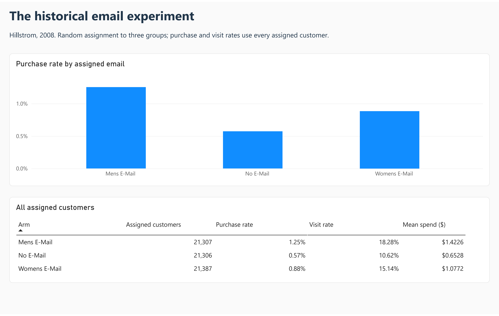
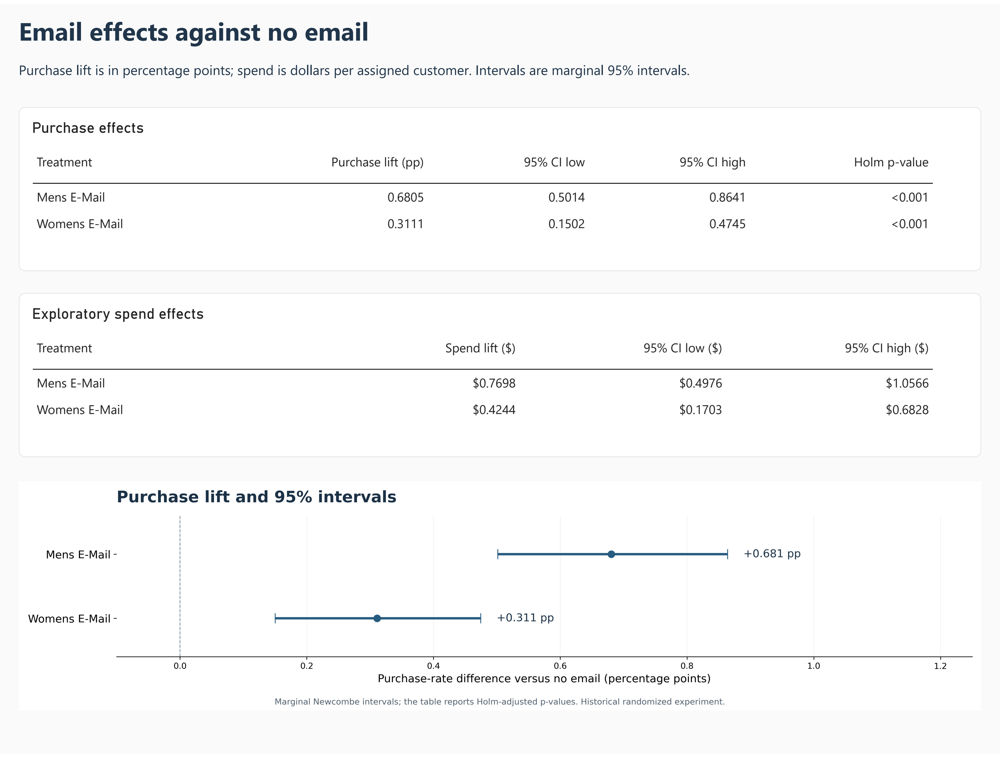

# Customer Journey, Conversion & Experimentation Analytics

Where do online shoppers drop off between viewing, adding to cart and buying, and did a past email campaign increase purchases?

I used two public datasets and analysed them separately: REES46 event logs from an electronics store (September 2020 to February 2021) for the purchase funnel, and the Hillstrom randomized email experiment (2008).

- 41.67% of events had no brand or no category. Dropping them would have changed the purchase share, so I kept them under an "Unknown" label.
- 3.67% of session-product groups went from view to cart to purchase in that order. For TVs it was 1.34%. The gap is worth investigating, but it does not prove a problem with the TV pages.
- In the email experiment, the Mens-merchandise email raised the purchase rate by 0.6805 percentage points compared with no email, and the Womens-merchandise email by 0.3111 points. Both stay significant after correcting for testing two emails (Holm method).

## Results

- [Notebook with saved outputs](Customer_Conversion_Analysis.ipynb) · [Python modules](src/)
- [SQL queries](analysis.sql)
- [Power BI report](Customer_Conversion.pbix)
- [Dashboard pages as PDF](Dashboard.pdf)
- [Full result tables (PDF)](Tables.pdf)
- [Decision memo](reports/11_executive_memo.md)

## Data and scope

The two datasets are never joined. Purchase events are not verified orders or profit, and the 2008 email results do not show how a campaign would perform today.

[REES46](https://rees46.com/en/datasets) · [Kaggle distribution](https://www.kaggle.com/datasets/mkechinov/ecommerce-events-history-in-electronics-store) · [Hillstrom](https://blog.minethatdata.com/2008/03/minethatdata-e-mail-analytics-and-data.html) · [Source and file-handling notes](docs/12_source_and_release_policy.md)

## Run

The notebook is saved with its outputs, so it can be read on GitHub without running anything. Raw source files and the local SQLite model are not included in this repository (see Data and scope). Re-running the notebook requires downloading the sources first.

```bash
pip install -r requirements.txt
```

## Dashboard

Report pages are below. Click an image to open its full resolution.

### 01 Customer journeys

[](images/01_overview.png)

### 02 Measurement and data quality

[](images/02_metrics_quality.png)

### 03 Purchase journeys by category

[](images/03_category_funnel.png)

### 04 Purchase journeys by price

[](images/04_price_funnel.png)

### 05 The historical email experiment

[](images/05_email_experiment.png)

### 06 Email effects against no email

[](images/06_experiment_effects.png)

## Dashboard reading notes

Counts use the units shown in the rate definitions. Category groups can overlap. The category page shows the 15 largest categories by eligible journey groups. All 108 categories are in the [full result tables](Tables.pdf). Price bands are ordered by their numeric lower bound. The purchase-effect chart uses the same marginal Newcombe 95% intervals as the results table; the Holm-adjusted p-values below 0.001 are displayed as `<0.001`. Spend effects remain exploratory.
